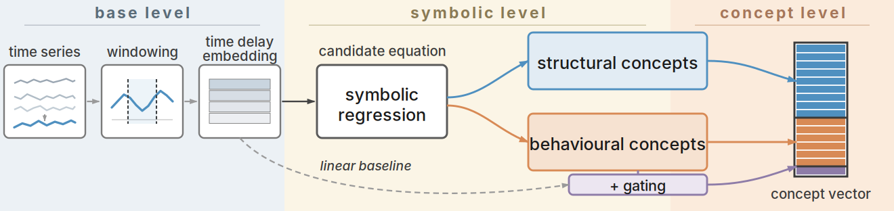
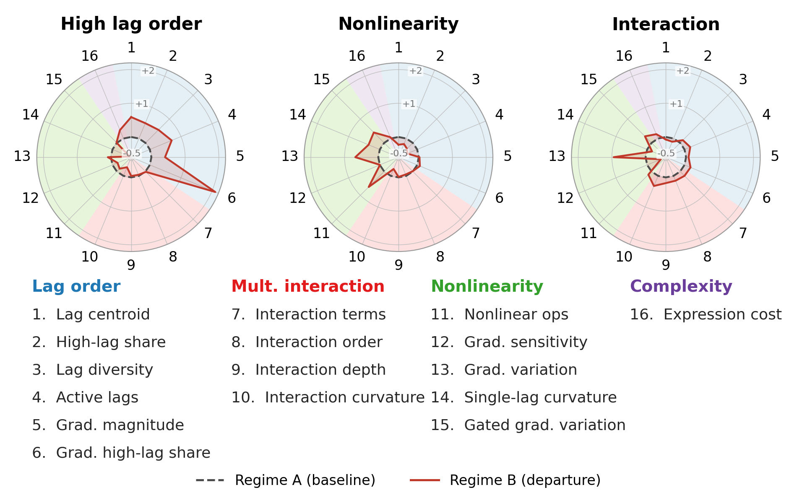
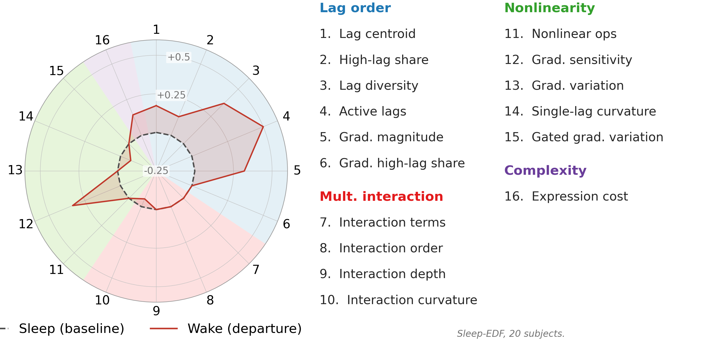

# Symbolic Regression for Interpretable Time Series Regime Characterization

[](LICENSE)
[](pyproject.toml)

Code for the paper *Symbolic Regression for Interpretable Time Series Regime Characterization* (Passos, Inácio, Santos, and Soares).

A regime is a stretch of a time series whose dynamics differ from the stretches around it. This repo characterizes how two regimes differ, rather than only locating where they change. It fits a set of symbolic regression expressions to each window and extracts two families of concepts from them: structural concepts from the structure of the expressions (lag order, multiplicative interaction, nonlinearity, complexity) and behavioral concepts from their gradients and curvature. A gating step turns off the nonlinearity reading on windows that a linear baseline already explains, so a near-linear window fitted with nonlinear operators does not register as nonlinear.

The method needs no concept labels and no prior specification of which properties separate the regimes. On synthetic autoregressive data it separates a regime pair matched in mean, variance, and autocorrelation, stays silent when two regimes share their dynamics, and identifies a lag-order difference between Wake and Sleep on Sleep-EDF EEG.



## Install

```bash
python3 -m venv .venv
.venv/bin/pip install -e .[dev]
```

Optional extras: `data` rebuilds the Sleep-EDF dataset, `baselines` adds the
classical time-series baselines:

```bash
.venv/bin/pip install -e .[dev,data,baselines]
```

To reproduce the paper against the exact dependency versions, install the pins
first: `.venv/bin/pip install -r requirements-lock.txt`.

Symbolic regression runs on [PySR](https://github.com/MilesCranmer/PySR), which needs a Julia runtime and compiles its backend on first use. If Julia is unavailable, pass `--symbolic-backend random` to use the built-in fallback search instead.

## Quickstart

Run the method on one synthetic scenario:

```bash
.venv/bin/ssp run-synthetic \
  --preset standard \
  --scenario memory_only \
  --output-dir outputs/memory_only
```

`--preset` trades budget for speed: `quick` (smoke test), `mvp`, `standard`, `research`. The synthetic scenarios are `memory_only`, `nonlinearity_only`, `interaction_only`, and `amplitude_only`. Each run writes per-window descriptors, regime profiles, pairwise statistics, fitted expressions, and a `summary.md`.

Run on your own labeled series:

```bash
.venv/bin/ssp run-csv \
  --preset mvp \
  --data-csv data/labeled_series.csv \
  --label-col regime \
  --feature-cols y \
  --time-col timestamp \
  --target-col y \
  --output-dir outputs/real_run
```

The CSV needs one row per time step, a label column with regime identifiers, and at least one numeric feature column. A time column and a record column are optional; a record column enables record-aware windowing and leave-one-record-out replication.

## Reproducing the experiments

The paper reports two settings: synthetic AR(2) data and the Sleep-EDF benchmark. The symbolic-regression runs take hours and need a Julia runtime for PySR; everything downstream (baselines, inference, tables, figures) recomputes from the run outputs in seconds to minutes. A `Makefile` wraps the steps:

```bash
make synthetic-run        # the synthetic symbolic-regression run (slow)
make sleep-run            # the Sleep-EDF symbolic-regression run (slow)
make paper-artifacts      # baselines, inference, tables and figures from the runs
# or run a single group: make baselines | make inference | make tables | make figures
```

### Synthetic (20 seeds)

Each scenario is a regime pair that isolates one property (memory, nonlinearity, interaction, amplitude). The interaction pair is matched in mean, variance, and autocorrelation, so summary-statistic baselines cannot tell its regimes apart.

```bash
scripts/run_synthetic.sh                                   # 20-seed run -> outputs/synthetic
.venv/bin/python scripts/synthetic_baselines.py            # classical baselines (incl. skewness, kurtosis)
.venv/bin/python scripts/across_seed_inference.py          # across-seed test -> figures/results_master.csv
.venv/bin/python scripts/bilinear_baseline_interaction.py  # bilinear oracle-vs-blind interaction baseline
```

### Sleep-EDF

Build the 20-subject dataset, then run the method and the across-subject analysis:

```bash
# build the 20-subject CSV and write one CSV per subject (--split-dir)
.venv/bin/python scripts/prepare_sleep_edf_small.py --label-mapping wake_sleep \
  --subjects 0,1,2,3,4,5,6,7,8,9,10,11,12,13,14,15,16,17,18,19 --recordings 1 \
  --output data/external/sleep_edf_ws_20subjects.csv \
  --split-dir outputs/sleep_edf/subjects

scripts/run_sleep_edf.sh                                   # per-subject runs -> outputs/sleep_edf
.venv/bin/python scripts/across_subject_inference_edf.py   # across-subject Wake-vs-Sleep test
.venv/bin/python scripts/sleep_edf_baselines.py            # signal-moment baselines
.venv/bin/python scripts/edf_memory_validation.py          # model-free lag-order validation
```

### Tables and figures

`scripts/build_tables.py [specificity|sleep|all]` writes the paper's two tables. Each figure has its own script: `scripts/render_fig_pipeline.py` (pipeline) and `scripts/fig_concept_radar.py` / `scripts/fig_concept_radar_edf.py` (the concept radars shown below).

### Validation harness

`ssp run-validation` runs a three-level harness (computational correctness, measurement sensitivity, robustness) and supports stage-by-stage resumable runs:

```bash
.venv/bin/ssp run-validation --suite synthetic --preset quick \
  --symbolic-backend random --output-dir outputs/validation_smoke
```

`outputs/` holds working artifacts and is not version controlled; recreate it with the commands above.

### Reproducibility notes

- The synthetic runs use 20 seeds (`run_synthetic.sh`); the generator is seeded, so the baseline scripts regenerate the windows deterministically without stored signals. Sleep-EDF uses the 20-subject cohort at 1 Hz with non-overlapping 160-sample windows.
- Statistical settings: per-pair block-permutation tests (block size 3), Benjamini-Hochberg across each family, and a detection gate of significant `q < 0.05` and Cliff's `|delta| >= 0.147`.
- PySR depends on a Julia runtime and is deterministic per seed but sensitive to the PySR/Julia version; `requirements-lock.txt` pins the Python side. Expect the full synthetic run to take several hours on a workstation.

## Results



On each synthetic scenario the perturbed regime (red) departs from the baseline regime (dashed) mainly along the concept axes that match the property it isolates: lag-order concepts for the memory regime, nonlinearity concepts for the nonlinear regime, and interaction concepts for the multiplicative regime.



On Sleep-EDF, Wake (red) departs from Sleep (dashed) along the lag-order and gradient concepts across 20 subjects. See the paper for the full tables and baseline comparisons.

## Data availability

No raw data is shipped in the repository. The synthetic data is generated in-process by the seeded generator in `src/symbolic_structural_profiling/synthetic.py`. The EEG data is the Sleep-EDF Expanded database (Sleep Cassette, one EEG channel) from [PhysioNet](https://physionet.org/content/sleep-edfx/), used under its original license; `scripts/prepare_sleep_edf_small.py` downloads it through MNE and writes the labelled CSV under `data/external/` (which is git-ignored).

## Repository layout

```
src/symbolic_structural_profiling/   method: windowing, symbolic fitting, descriptors, stats, validation
scripts/                             dataset prep, experiment runners, baselines, tables, figures
tests/                               unit and integration tests
data/external/                       datasets you build locally (not version controlled)
figures/                             generated figures and the results CSVs they read
```

## License

Released under the MIT License; see [LICENSE](LICENSE). The bundled Sleep-EDF data is covered by its own PhysioNet license.
